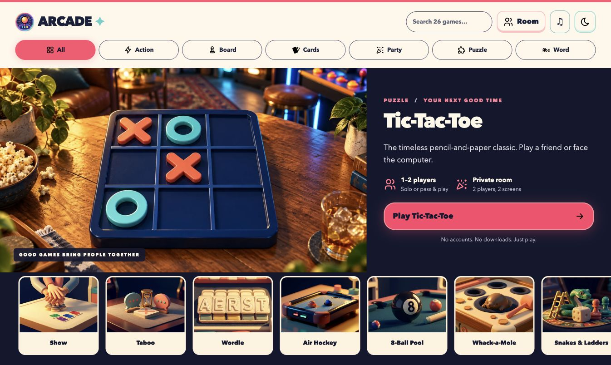
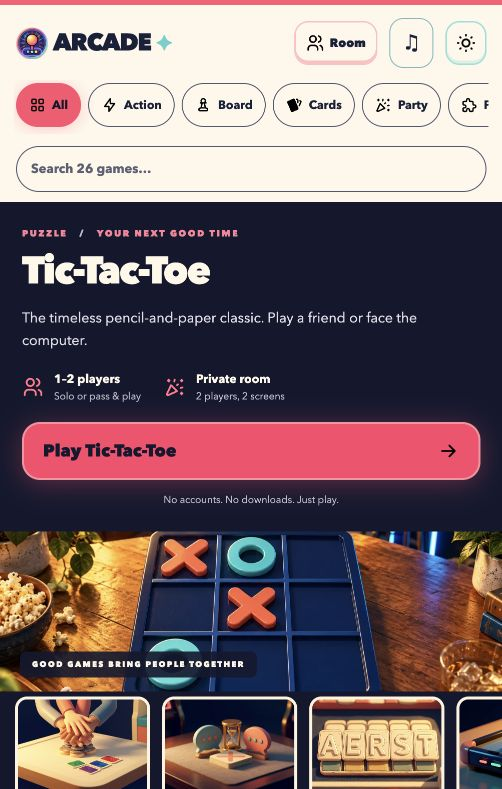
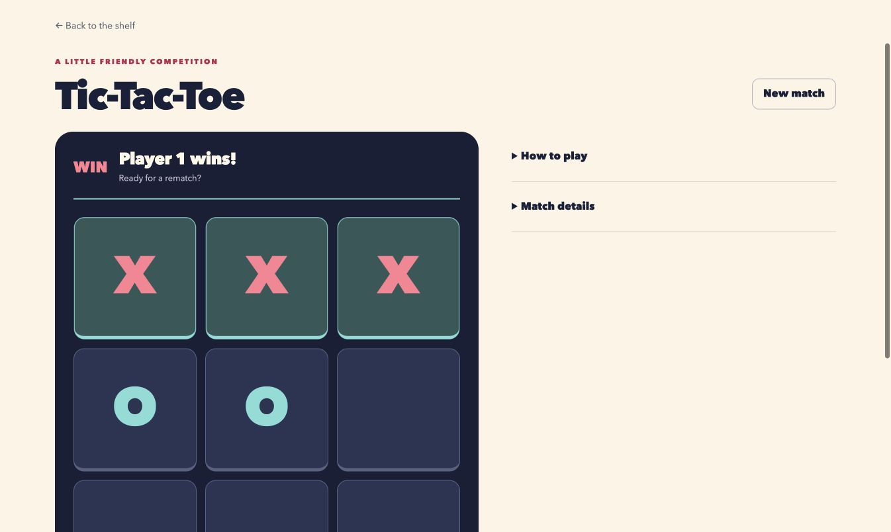
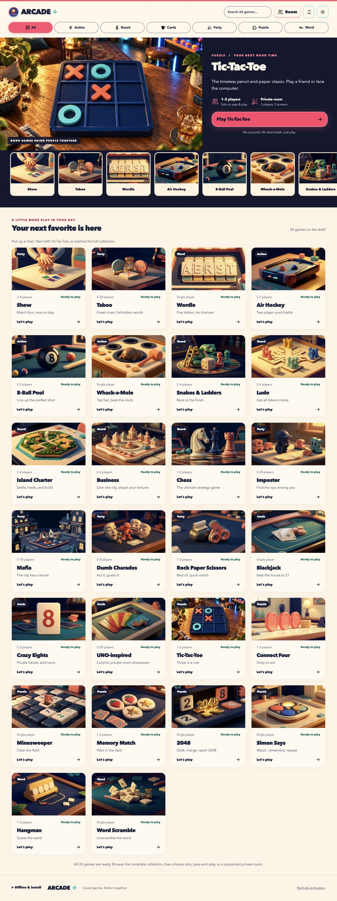

<div align="center">

# 🕹️ Arcade

**26 beautifully illustrated games in one installable shelf — play solo, pass the device, or open a private peer-to-peer room.**

[](https://venkate5hgunda.github.io/arcade/)
[](https://github.com/venkate5hgunda/arcade/actions/workflows/pages.yml)
[](https://github.com/venkate5hgunda/arcade/actions/workflows/ci.yml)


<a href="https://venkate5hgunda.github.io/arcade/">
  
</a>

*The live Living Game Shelf — no account, app store, or game server required.*

</div>

## ✨ One shelf, lots of ways to play

| | |
| --- | --- |
| 🎨 **26 distinct games**<br>Every title has its own inspected cover, setup, rules, saved state, and playable native interface. | 🤝 **11 private-room games**<br>Serverless WebRTC rooms support private hands, roles, cargo, spectators, reconnects, and standings. |
| 📱 **Made for every screen**<br>Responsive touch and keyboard controls, light/dark themes, reduced motion, sound, and optional haptics. | 📴 **Installable and offline**<br>The complete production asset graph is cached locally, with safe updates and resumable matches. |

<p align="center">
  
  &nbsp;&nbsp;
  
</p>

The screenshot above follows a real pass-and-play match from setup through a Player 1 win. Prefer a different table? Search or filter the shelf, resume an unfinished match, or create a private room without signing in.

## 🎲 Browse all 26 games

| Category | Games |
| --- | --- |
| ⚡ **Action** | Air Hockey · 8-Ball Pool · Whack-a-Mole |
| ♟️ **Board** | Snakes & Ladders · Ludo · Island Charter · Business · Chess |
| 🃏 **Cards** | Blackjack · Crazy Eights · UNO-inspired |
| 🎉 **Party** | Show · Taboo · Imposter · Mafia · Dumb Charades · Rock Paper Scissors |
| 🧩 **Puzzle** | Tic-Tac-Toe · Connect Four · Minesweeper · Memory Match · 2048 · Simon Says |
| 🔤 **Word** | Wordle · Hangman · Word Scramble |

<details>
<summary><strong>Open the full live shelf inventory</strong></summary>
<br>

</details>

Player counts, modes, and game-specific notes live in the [complete game catalog](docs/games.md).

## 🌐 Choose your table

| Mode | Best for | How it works |
| --- | --- | --- |
| **Solo** | Puzzles, practice, quick rounds | Start immediately; progress and scores stay on your device. |
| **Pass & play** | Friends around one screen | Arcade announces the turn, hides private information during handoffs, and resumes interrupted rounds. |
| **Private room** | Separate phones or laptops | Exchange invitation and answer links; gameplay travels directly between peers through WebRTC. |
| **Spectator** | Watching a room match | Public boards and results stay visible while private hands, roles, ballots, and cargo remain hidden. |

Rooms require no account or signaling server. Some restrictive networks can block direct WebRTC connections; see [how rooms work](docs/rooms.md) for invitations, QR codes, reconnects, privacy, and supported games.

## 🚀 Run it locally

The production app lives in `redesign/` and uses Node 22.12+.

```bash
npm --prefix redesign ci
npm --prefix redesign run dev       # http://127.0.0.1:5174
```

```bash
npm --prefix redesign test          # inventory + domain/protocol checks
npm --prefix redesign run build     # type-check + production build
npm --prefix redesign run test:browser
```

The original root application remains as the migration baseline and rollback reference. Its regression suites run with `npm test` and `npm run test:movies`.

## 📚 Documentation

| Start here | What it covers |
| --- | --- |
| [Game catalog](docs/games.md) | Every title, player count, category, and special option |
| [Features](docs/features.md) | Themes, sound, resume behavior, and game highlights |
| [Private rooms](docs/rooms.md) | Invites, answers, spectators, privacy, and reconnects |
| [Living Game Shelf](docs/redesign/README.md) | Production architecture, commands, parity, and redesign map |
| [Release qualification](docs/redesign/release-qualification.md) | Automated evidence and named physical-device/network checks |
| [Development](docs/development.md) | Original baseline, repository map, and game maintenance |
| [Architecture](docs/ARCHITECTURE.md) | System ownership and maintenance boundaries |
| [Design language](docs/DESIGN_LANGUAGE.md) | Visual system, accessibility, and interaction principles |
| [Rules](docs/rules/) | Detailed rules for Business, Mafia, and other documented editions |
| [Credits](docs/credits.md) | Artwork, icons, licenses, and attribution |

## 🗂️ Repository map

```text
redesign/             production React + TypeScript + Vite PWA
docs/redesign/        migration decisions, parity, QA, and release evidence
docs/images/          captures from the real app
games/, js/, css/     original Arcade migration baseline
data/movies/, dev/    approved movie data and maintainer tooling
test/                 original baseline regression suites
```

## 📄 License

[MIT](LICENSE) © 2026 Venkatesh Gunda. Third-party artwork and code retain their own licenses; see [credits](docs/credits.md).
