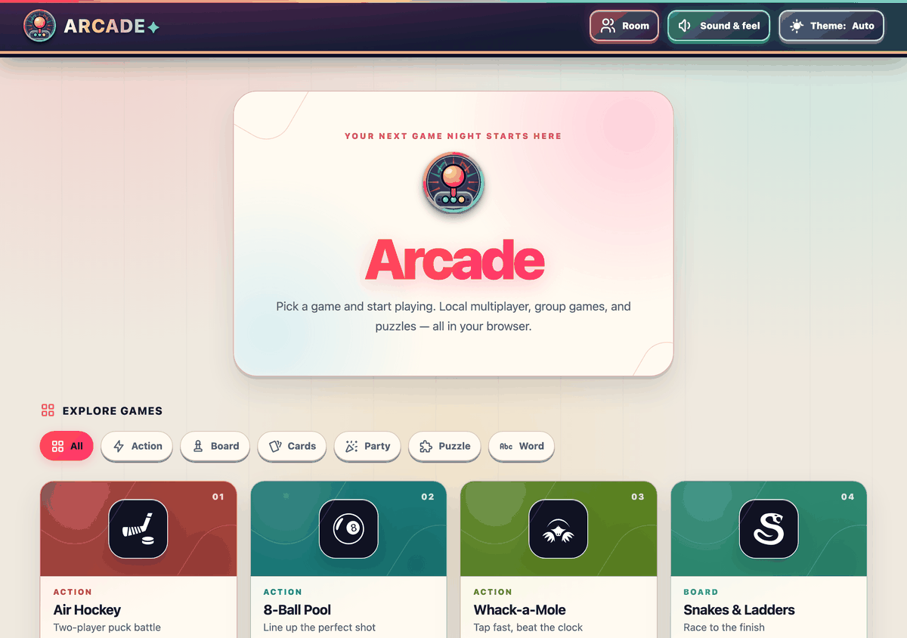
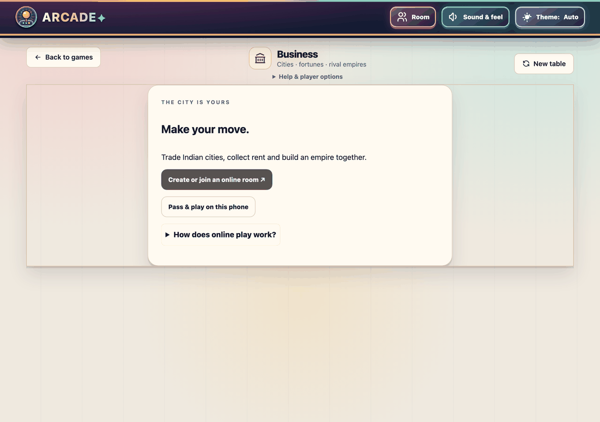
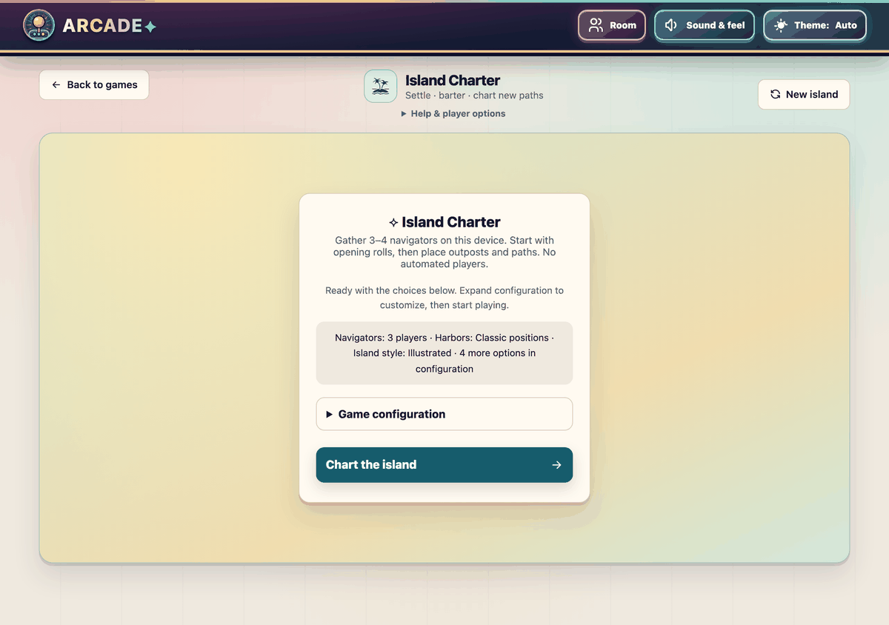
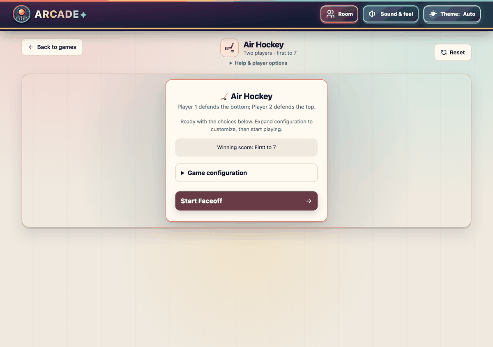
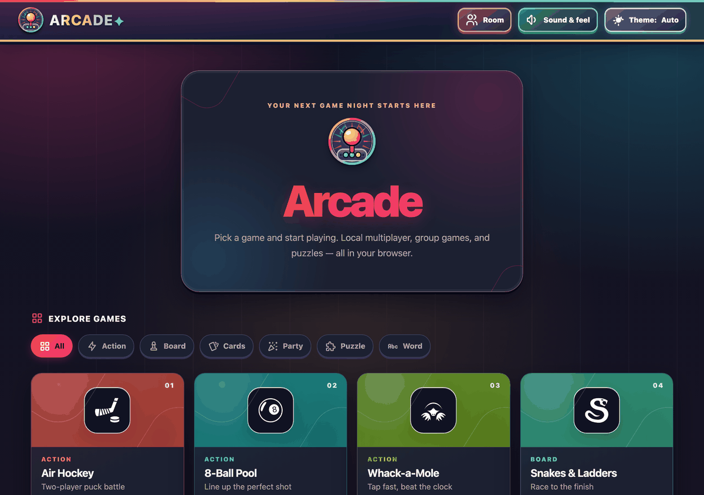
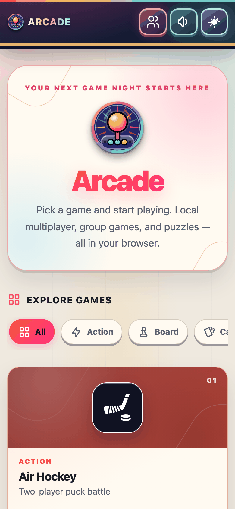

<div align="center">

# 🕹️ Arcade

**26 games. One installable app. Zero servers.** Action, board, card, party, puzzle and word games — solo, pass-and-play, or in private peer-to-peer rooms.

[](https://venkate5hgunda.github.io/arcade/)




</div>

## ✨ Highlights

- 🎮 **26 games** — Air Hockey, Pool, Chess, Ludo, Business, Island Charter, Mafia, UNO-inspired, 2048 and more. [See the catalog](docs/games.md).
- 🌐 **Private rooms** — serverless WebRTC multiplayer with hidden hands kept on the host. [How rooms work](docs/rooms.md).
- 📱 **Installable & offline** — a service worker caches everything; rounds resume where you left off.
- 🌗 **Bright and accessible** — light/dark themes, synthesized sound, haptics, reduced-motion and WCAG AA contrast.

<p align="center">
  
  
  
</p>

## 🚀 Quick start

```bash
npm start          # python3 dev/serve.py → http://localhost:8000
npm test           # JavaScript tests
npm run test:movies  # Python movie-pipeline tests
```

Use the project server rather than a generic static server; it blocks `.env`, hidden files and development data.

## 📚 Documentation

| Topic | Page |
| --- | --- |
| Every game, player counts, Imposter and movie options | [docs/games.md](docs/games.md) |
| Arcade features: themes, sound, resume, per-game highlights | [docs/features.md](docs/features.md) |
| Playing on separate devices (invites, answers, reconnects) | [docs/rooms.md](docs/rooms.md) |
| Running locally, project layout, adding a game | [docs/development.md](docs/development.md) |
| Architecture and maintenance map | [docs/ARCHITECTURE.md](docs/ARCHITECTURE.md) |
| Design language | [docs/DESIGN_LANGUAGE.md](docs/DESIGN_LANGUAGE.md) |
| Game rules: [Business](docs/rules/business.md) · [Mafia](docs/rules/mafia.md) | |
| Scope notes and limitations | [docs/limitations.md](docs/limitations.md) |
| Changelog | [docs/CHANGELOG.md](docs/CHANGELOG.md) |
| Telugu movie catalog pipeline | [dev/movies/README.md](dev/movies/README.md) |
| Icon credits | [docs/credits.md](docs/credits.md) |

<p align="center">
  
  
</p>

## 🗂️ Repository layout

```
index.html, manifest.json, sw.js   app shell and PWA
css/, js/, games/, assets/         app code, one module per game
data/movies/                       public movie prompt data
dev/                               local server and movie tooling
test/                              tests
docs/                              documentation, rules and screenshots
```

## 📄 License

[MIT](LICENSE) © 2026 Venkatesh Gunda. Third-party artwork and code stay under their own licenses — see [credits](docs/credits.md) and `js/vendor/`.

## 🧭 Redesign

The framework redesign is being developed on `codex/redesign-foundation`. See the [requirements, architecture and runnable foundation](docs/redesign/README.md) for scope, local preview and feature-parity tracking.
