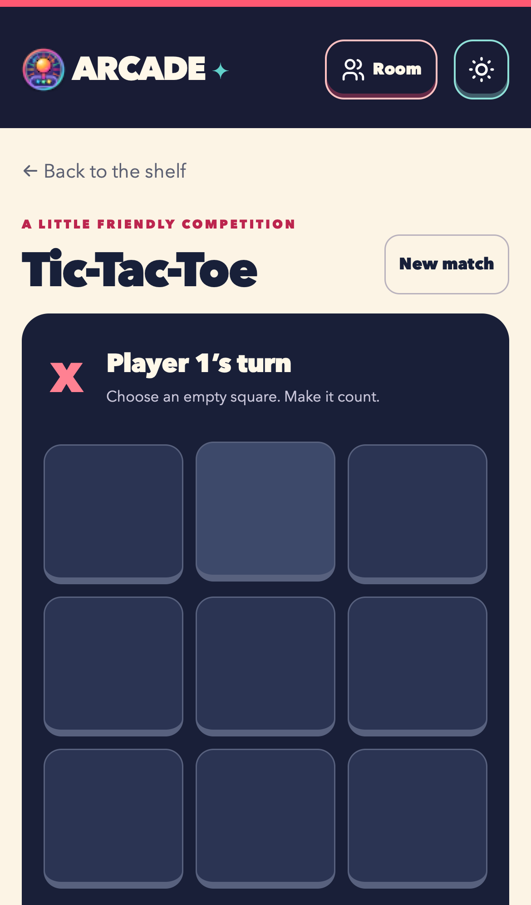

# Arcade · Living Game Shelf

A vibrant, illustrated shelf for good games and better company.

**All 26 games have native implementations and distinct custom artwork.** Browse the Living Game Shelf, resume saved games, and play eleven supported games in private rooms. The requirements explorer remains at `#/requirements/:id`.

Game ports are complete; shared room features and release qualification remain in the [backlog](backlog.md). This is a reviewable migration milestone, not a production deployment.

| Document | Purpose |
| --- | --- |
| [Requirements](requirements.md) | Acceptance criteria and original behavior evidence |
| [Architecture](architecture.md) | React/TypeScript ownership and state boundaries |
| [Migration and decisions](migration.md) | Prior decisions, data contracts and rollout |
| [Verification](verification.md) | Current test evidence and trace findings |
| [Design QA](design-qa.md) | Reference comparison and responsive checks |
| [Game ports](game-ports.md) | Family-by-family migration status and current evidence |
| [Backlog](backlog.md) | Remaining shared features and release work |
| [Artwork](artwork.md) | Illustration and icon provenance |
| [Art guide](art-guide.md) | Required visual theme and generation brief for every Arcade image |
| [Parity inventory](parity.json) | Honest implemented and partial scopes |
| [Source snapshot](source-snapshot.json) | Frozen baseline source inventory |

## Play locally

Use Node 22.12+; CI and baseline tests use Node 22.

```sh
npm --prefix redesign ci
npm --prefix redesign run dev
# http://127.0.0.1:5174
```

```sh
npm --prefix redesign test
npm --prefix redesign run build
npm --prefix redesign exec -- playwright install chromium webkit
npm --prefix redesign run test:browser
npm --prefix redesign run capture
```

Tests and captures normally start their own production preview. To use a preview you already started on port 5174, set `ARCADE_REUSE_PREVIEW=1`. All generated checks/build files stay in `redesign/node_modules/.cache/`.

## A private table

1. Open **Room**, enter a name, and create a room.
2. Send the generated invitation using **Share link**, **Copy link**, or the expandable **QR code**. The guest opens or scans it, enters a name, and returns their answer link.
3. Paste or scan the answer in the original host tab, then select a game and start once every player connects. Use **Invite another player** before starting to build a larger table. Game options reflect the connected player count.
4. After a disconnect or host reload, create a reconnect invitation. The guest joins with the same room name and returns a fresh answer. Reconnect every disconnected seat. The board, private deck/hands and standings survive in the host tab.

Rooms use version 8 connection links and real WebRTC, public Google STUN when online, and manual signaling. There is no signaling server or TURN relay. Restrictive networks may prevent connection; use another network. Invitation links contain connection metadata: share them only with the intended player. No account or microphone is required. Camera scanning is optional and requires HTTPS (or localhost) and camera permission. QR generation and scanning run locally; a long link may exceed QR capacity, in which case use copy/share.

Use a separate preview origin: the redesign deliberately preserves the original `arcade:` local-data contracts. It does not register a service worker or migrate production data. Root commands still run the original application.

## Preview


| Mobile shelf | Mobile match |
| --- | --- |
|  |  |

Baseline: [`ae1136d6e544`](https://github.com/venkate5hgunda/arcade/commit/ae1136d6e544784811e5c334ee76d6c54b6921a3). First milestone: `codex/redesign-first-game` → `codex/redesign-foundation`. Puzzle ports: `codex/redesign-puzzle-games` → `codex/redesign-first-game`, stacked while the first PR is reviewed.
