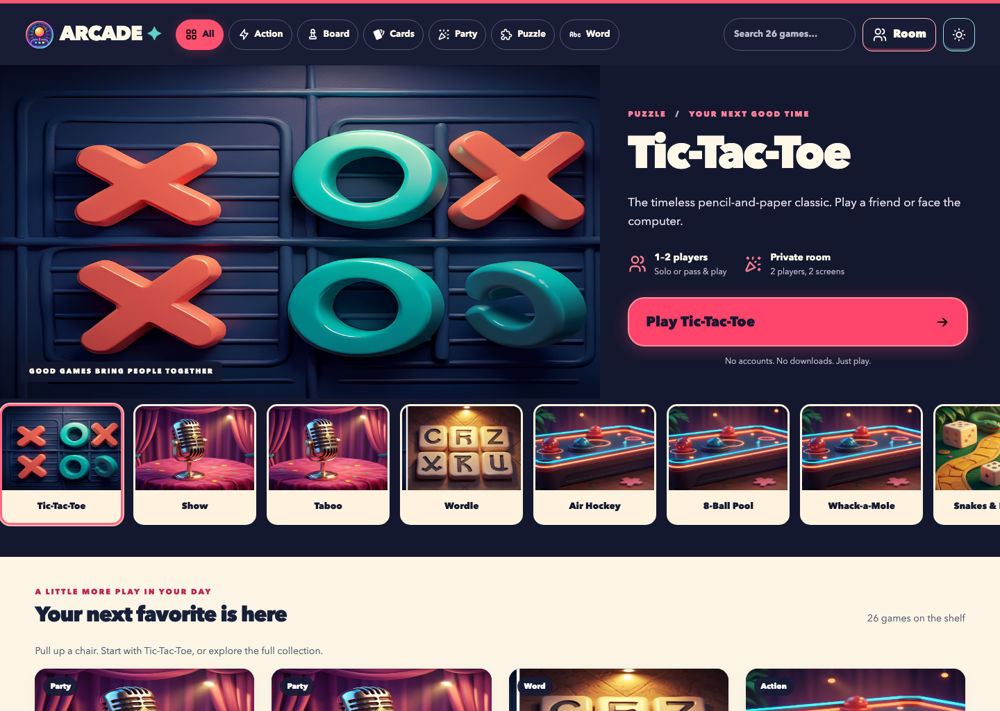
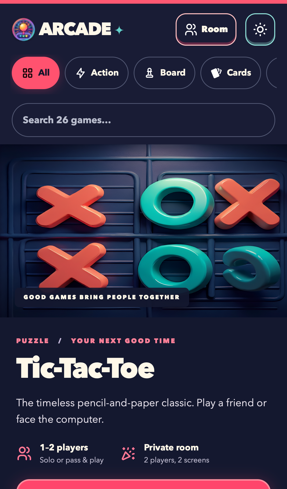

# Arcade · Living Game Shelf

A vibrant, illustrated shelf for good games and better company.

**Phase 2 is implemented:** browse all 26 stable catalog entries, play a complete local or private-room Tic-Tac-Toe match, resume a saved board, and reconnect a room after a host reload. The selected **Living Game Shelf** design replaces the foundation explorer as the home screen. The requirements explorer remains at `#/requirements/:id`.

The other 25 games link to their working original Arcade versions. This is a reviewable migration milestone, not the full parity release or a production deployment.

| Document | Purpose |
| --- | --- |
| [Requirements](requirements.md) | Acceptance criteria and original behavior evidence |
| [Architecture](architecture.md) | React/TypeScript ownership and state boundaries |
| [Migration and decisions](migration.md) | Prior decisions, data contracts and rollout |
| [Verification](verification.md) | Current test evidence and trace findings |
| [Design QA](design-qa.md) | Reference comparison and responsive checks |
| [Backlog](backlog.md) | Remaining game families and release work |
| [Artwork](artwork.md) | Illustration and icon provenance |
| [Parity inventory](parity.json) | Honest implemented and partial scopes |
| [Source snapshot](source-snapshot.json) | Frozen baseline source inventory |

## Play locally

Use Node 22.12+; CI and baseline tests use Node 22.

```sh
npm --prefix redesign ci
npm --prefix redesign run dev
# http://127.0.0.1:5174
```

```sh
npm --prefix redesign test
npm --prefix redesign run build
npm --prefix redesign exec -- playwright install chromium webkit
npm --prefix redesign run test:browser
npm --prefix redesign run capture
```

Tests and captures normally start their own production preview. To use a preview you already started on port 5174, set `ARCADE_REUSE_PREVIEW=1`. All generated checks/build files stay in `redesign/node_modules/.cache/`.

## A table for two

1. Open **Room**, enter a name, and create a room.
2. Send the generated invitation to one guest. They open it, enter their name, and return their answer link.
3. Paste that answer into the original host tab. When both seats connect, start Tic-Tac-Toe.
4. After a disconnect or host reload, create a reconnect invitation. The guest joins with the same room name and returns a fresh answer. The board and standings survive in the host tab.

Rooms use real WebRTC, public Google STUN when online, and manual signaling. There is no signaling server or TURN relay. Restrictive networks may prevent connection; use another network. Invitation links contain connection metadata: share them only with the intended player. No account, camera or microphone is required.

Use a separate preview origin: the redesign deliberately preserves the original `arcade:` local-data contracts. It does not register a service worker or migrate production data. Root commands still run the original application.

## Preview





Baseline: [`ae1136d6e544`](https://github.com/venkate5hgunda/arcade/commit/ae1136d6e544784811e5c334ee76d6c54b6921a3). Review branch: `codex/redesign-first-game`, targeting `codex/redesign-foundation`.
