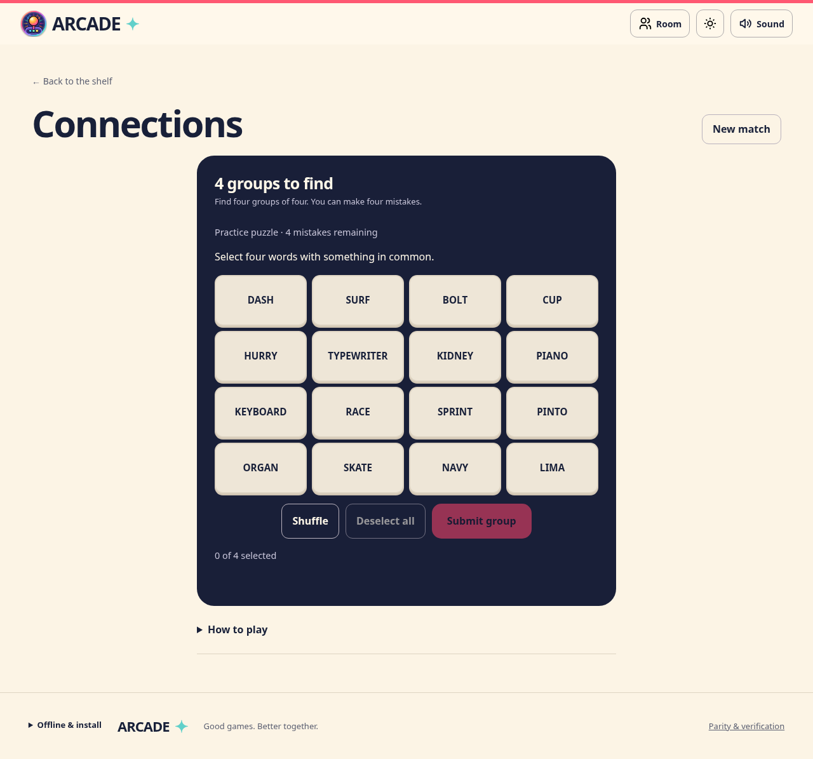
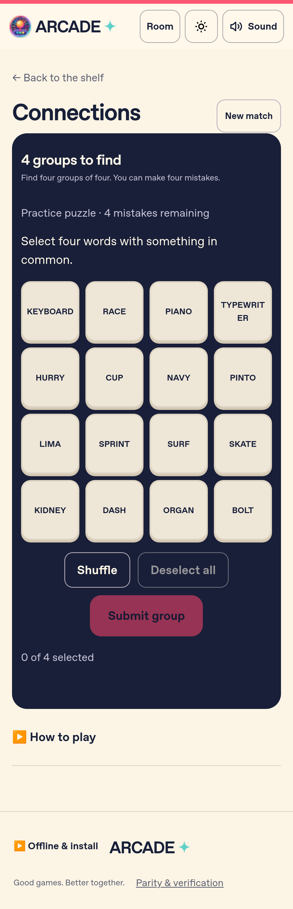

# Connections

The first addition from the Todoist game list. Available at `#/game/connections`
and the legacy alias `#/games/connections` in the production React app.

Find four groups of four words in a 16-word board. Four incorrect guesses end
the puzzle and reveal the remaining categories. Repeated guesses, including
reordered repeats, cost no mistakes. Three words from one category produce a
"One away" hint. Solved words leave the selectable grid. Selection, shuffle,
arrow-key navigation and native Enter/Space buttons work on touch and keyboard.

## Content and local progress

24 original authored word sets ship in `redesign/src/data/connections.ts`.
The daily puzzle uses the device's local calendar date and cycles every 24 days;
practice selects from the same bundled sets. This is a finite original offline
collection, not a feed of New York Times puzzles. Stable puzzle IDs and word
indices are a saved-data contract; append sets without rewriting an existing ID.

An unfinished checkpoint stores `{ puzzleId, date, guesses }` in the shared
session envelope, with a 24-hour inactivity expiry. Validation replays every
guess, rejecting foreign puzzles, invalid dates, duplicate/solved words and
post-result moves. Finished games clear the resumable checkpoint. Daily puzzles
can be replayed; practice offers another round. The existing offline build graph
includes the code, bundled sets and dedicated local cover automatically.

## Multiplayer

Players can cooperate around one device or choose **Solve together in a private
room** for 2–20 devices. Every connected player may submit a group. Selections
and shuffling stay on the player's screen; guesses, history, solved groups and
the four-mistake budget are shared. No chat or game backend is required.

The host accepts only valid participant submissions for the current round and
revision. Concurrent guesses using an old revision are ignored after the first
accepted guess updates everyone. Spectators cannot act. Every player must be
connected before submitting; spectator disconnects do not pause the puzzle.
The host's tab backup restores the exact puzzle and progress, with same-seat
reconnect invitations. Team wins/losses are recorded once for all players and
never credited to spectators. The host starts practice rounds or changes games
through the existing lobby.

The current room protocol v11 rejects older connection links with reload guidance. Valid v1–v10
host backups still recover through new v11 invitations. The original JavaScript
app remains the frozen migration baseline; Connections extends the production
registry and has its own G27 requirement.

## Verification

- `redesign/checks/unit/connections.check.ts`: all 24 sets, daily selection,
  every solution, incorrect/duplicate/illegal guesses, terminal rules, immutable
  transitions, checkpoint replay and feedback.
- `redesign/checks/unit/room.check.ts`: participant/spectator authority,
  concurrent revisions, malformed/mixed snapshots, reconnects, team standings,
  result deduplication, lobby/rematch and v9 backup/link compatibility.
- `redesign/checks/browser/connections.spec.ts`: desktop/mobile local play,
  reload, repeat feedback, keyboard, answer reveal, practice, cover decoding,
  320px overflow, accessibility and real two-context WebRTC recovery/completion.
- `redesign/checks/browser/pwa.spec.ts`: offline graph and all production routes.

Browser evidence uses Chromium and mobile WebKit. Physical devices and separate
networks retain the existing release qualification limitations.

The cover follows the [art guide](art-guide.md), with accepted prompt, source,
hash and inspection notes in the [artwork manifest](artwork-manifest.json).

## Browser captures

| Desktop | Mobile WebKit |
| --- | --- |
|  |  |
