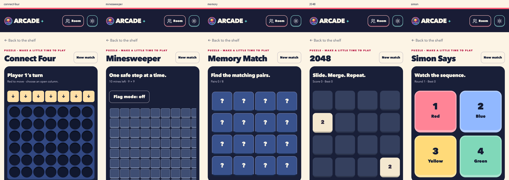
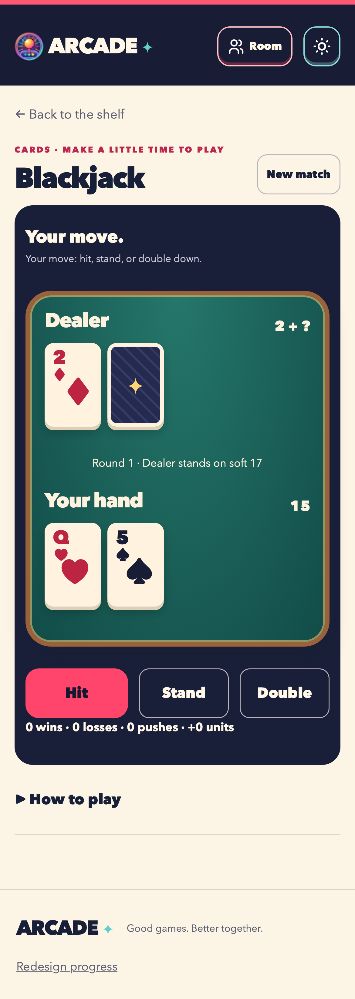
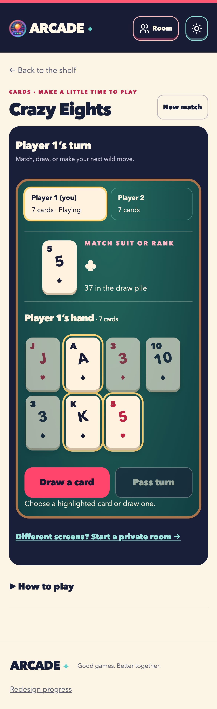
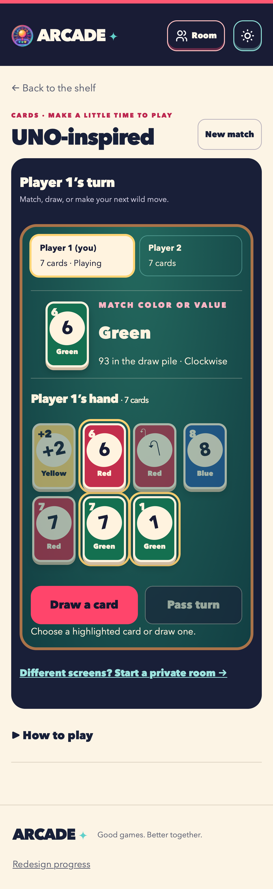

# Game migration status

**13 of 26 games are implemented.** The remaining 13 are authorized and tracked in the [backlog](backlog.md). PR #2's first-game work is complete and remains unmerged for review; puzzle ports are a stacked review unit on `codex/redesign-puzzle-games`.

| Family | Implemented | Remaining |
| --- | --- | --- |
| Puzzle | Tic-Tac-Toe, Connect Four, Minesweeper, Memory Match, 2048, Simon Says | None |
| Cards | Blackjack, Crazy Eights, UNO-inspired | None |
| Board | Snakes & Ladders, Ludo | Island Charter, Business, Chess |
| Action | — | Air Hockey, 8-Ball Pool, Whack-a-Mole |
| Party | — | Show, Taboo, Imposter, Mafia, Dumb Charades, Rock Paper Scissors |
| Word | Wordle, Hangman | Word Scramble |

## Puzzle acceptance and evidence

- **Connect Four:** local one/two-player options, baseline heuristic AI, gravity/full-column enforcement, winning lines, draw/reset, checkpoint recovery, real two-browser authoritative room play and host-reload recovery.
- **Minesweeper:** all three baseline sizes, first-reveal neighborhood safety, preflags, flood reveal, flag mode/right-click/F key, win/loss and validated saved fields. Wide fields scroll inside the board on mobile.
- **Memory Match:** 4/6/8 grids, one/two players, concealed cards, delayed mismatches, match-retains-turn/mismatch-handoff, pair scoring, win/tie/rematch and recovery. A pending mismatch checkpoint is normalized to the resulting hidden pair and next actor.
- **2048:** baseline once-per-move merging and score/record keys, arrow/swipe/button controls, staged movement/merge/spawn, queued input, 2048 continuation, no-op enforcement, game-over/reload behavior and reduced motion.
- **Simon Says:** all three speeds, growing sequence, locked watch phase, numbered/color-labelled pads, input success/failure, high scores, restored partial-round replay, rematch and timer cleanup.

Checks: `redesign/checks/unit/puzzles.check.ts`, `room.check.ts`, `redesign/checks/browser/puzzles.spec.ts` and `foundation.spec.ts`. Original game modules remain unchanged and serve as behavior references. All implemented flags, route consumers, checkpoint readers and room projections were traced together.

## Blackjack acceptance and evidence

Native solo Blackjack preserves the 52-card deck, ace handling, dealer standing on soft 17, hit/stand, two-card doubling, naturals paying 3:2, push/bust/settlement, session record and baseline-compatible five-minute checkpoint. Dealer hole cards expose no rank in the DOM until reveal. Natural initial deals finish immediately and cannot appear as resumable games. Fictional units only.

Evidence: `redesign/checks/unit/blackjack.check.ts` and `redesign/checks/browser/art-blackjack.spec.ts`; complete desktop/mobile flows, keyboard controls, accessibility, reload and record-preserving redeals. Shared audio/haptics remain A07 work.

## Private-card acceptance and evidence

- **Crazy Eights:** native two-player covered local hands and private rooms; suit/rank matching, wild-eight suit selection, one draw per turn, passing, discard recycling, empty-hand victory and blocked-hand penalty scoring. Choosing a suit survives reload; completed games are removed from local resume.
- **UNO-inspired:** native 2–20-player local tables and rooms; one/two decks, private hands, skip/reverse/+2/wild/+4, drawn-card restriction, challenge/accept, UNO callouts/catches, blocked termination, wins and replay. Names/settings/checkpoints retain baseline shapes. Reload covers local hands again.
- **Rooms:** independent host-to-guest data channels, strict seat projections, host-only deck backup, per-link sequence checks plus match round/revision, same-seat reconnect, pause while any player is disconnected and exactly-once results. Protocol v3 rejects older connection links. Valid v1 public and v2 private-card host checkpoints can be restored and re-invited using v3 links.

Evidence: `redesign/checks/unit/cards.check.ts`, `room.check.ts`, and `redesign/checks/browser/cards.spec.ts`. Typed engines are compared against the originals through complete games at 2/3/10/11/20 players. Twenty-seat protocol admission/projection/reconnect is checked with deterministic transports; real WebRTC browser flows cover two-player Crazy Eights and three-player UNO, including host reload, preserved private hands, complete wins and rematches. Physical-device/network qualification and broader shared room criteria remain release gates.

| Crazy Eights | UNO-inspired |
| --- | --- |
|  |  |

## Race-game acceptance and evidence

Snakes & Ladders and Ludo support 2–4 local or room players, baseline-compatible checkpoints and host-authoritative dice. Snakes preserves the original seeded board, exact finish and 99-to-21 snake. Ludo preserves token release, choice, safe squares, captures, extra turns and exact home. Players can inspect squares or select tokens using touch and keyboard; motion respects reduced-motion settings.

Evidence: `redesign/checks/unit/races.check.ts` compares seeded boards and legal moves with the original engines, and `room.check.ts` exercises four-seat recovery and forged-action rejection. `redesign/checks/browser/races.spec.ts` covers desktop/mobile complete local wins and rematches, accessibility, and three real WebRTC peers reconnecting after host reload. Cross-network and physical-device qualification remain release gates.

## Wordle acceptance and evidence

Wordle retains the original offline vocabulary, repeated-letter scoring, six guesses and local checkpoints. Players can type or use the on-screen keyboard; symbols accompany color feedback. Complete wins, losses, invalid guesses, reload, replay and accessibility are covered in `redesign/checks/browser/wordle.spec.ts`, with original vocabulary and scoring comparisons in `redesign/checks/unit/wordle.check.ts`.

## Hangman acceptance and evidence

Hangman retains the original 85-word pool, category clues, six misses, alternating two-player guesses, repeated-letter handling and compatible local checkpoints. Original-engine comparisons cover complete rounds in `redesign/checks/unit/hangman.check.ts`; `redesign/checks/browser/hangman.spec.ts` covers wins, losses, turns, clues, reload, replay, keyboard and accessibility on desktop and mobile.

## Porting rule

Keep each family reviewable and push completed units. Do not flip a game's parity record until complete gameplay and recovery have passed in desktop Chromium and mobile WebKit. Do not substitute original-app links, placeholder boards, simplified rules or a legacy iframe for a native game port. Shared PWA/audio/room breadth remain separate release gates.
